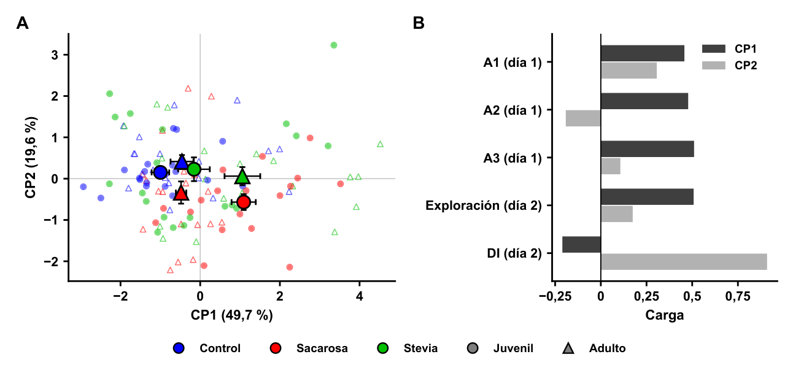
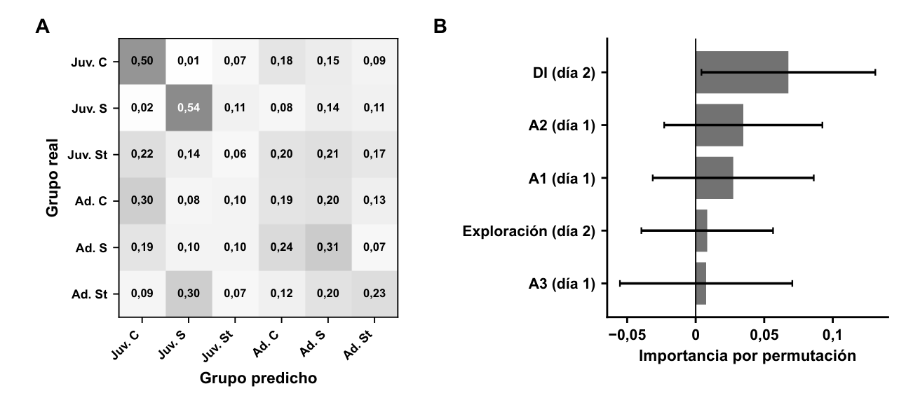

## Para qué sirve

La sacarosa se distingue del control porque discrimina peor la posición nueva. La stevia también se distingue del control, pero porque explora más, no porque discrimine peor. Y ningún grupo forma un perfil conductual separado de los demás.

Ese es el resultado de mirar las métricas de la SLR de cada animal todas juntas, en lugar de una por una como hace el ANOVA. El análisis responde a los dos objetivos de máxima de la tesis:

1. ¿Los animales se agrupan solos según su exposición, sin decirle al método a qué grupo pertenece cada uno? (objetivo de máxima 1: PCA y clustering de Ward)
2. ¿Las métricas permiten reconocer a qué grupo pertenece cada animal? (objetivo de máxima 2: Random Forest)

Este documento explica qué datos se usaron, qué hace cada método y qué dio, sin necesidad de saber programar. En la tesis está en las secciones 3.4 (fundamento), 4.6 (métodos), 5.6 (resultados) y 6.7 (discusión).

## Qué datos usamos

Se armó una tabla con una fila por animal: 117 animales de la SLR (18 a 20 por grupo, con la d-SLR y la s-SLR juntas) y cinco métricas por animal, todas registradas con AnyMaze.

| Métrica | Qué mide | Sesión | De dónde sale |
| --- | --- | --- | --- |
| A1 (s) | Tiempo explorando el objeto que después queda en su lugar | Día 1 (muestreo) | SLR_Dia1_exploracion_distancia_por_grupo.xlsx |
| A2 (s) | Tiempo explorando el segundo objeto | Día 1 (muestreo) | El mismo archivo |
| A3 (s) | Tiempo explorando el tercer objeto | Día 1 (muestreo) | El mismo archivo |
| Exploración total (s) | Tiempo explorando los dos objetos | Día 2 (prueba) | SLR_exploracion_D1_vs_D2 actualizado.xlsx |
| DI | Cuánto prefirió la posición nueva sobre la familiar | Día 2 (prueba) | Hoja ORIGEN de SLR PRISMA RESULTADOS.xlsx |

- **El DI es el mismo que está en Prism.** La hoja ORIGEN se completó leyendo las tablas cargadas en Prism, y los 117 valores coinciden exactamente con los exports de Prism.
- **Cómo se unió el día 1 con el día 2.** Cada animal del día 1 se emparejó con su registro del día 2 por edad, tratamiento, configuración, número del animal y sesión (el día 2 es de 1 a 4 días después). Se emparejaron los 117, sin ningún caso dudoso. Una aclaración: en la sesión del día 2 del 11/08/2026 ("ranas"), los animales stevia figuran como 6 a 10 y corresponden a stevia 1 a 5 del día 1.
- **Por qué solo la SLR.** Es la única prueba con los datos identificados por animal. El OF y el NOR están en tablas de Prism armadas por variable o por demora, en las que no se sabe qué valor de una variable corresponde a qué animal en otra.
- **Por qué se dejó afuera la distancia recorrida.** Con la distancia del día 1, el modelo reconocía el año del animal (2026 o 2024–2025) en el 83 % de los casos; sin ella, en el 62 %, una cifra no significativa (p = 0,066). Como todos los controles son de 2025, el modelo habría aprendido a reconocer la cohorte en lugar del tratamiento. Por eso la distancia quedó solo como análisis de control.

La tabla completa por animal está en el repositorio de la tesis (datos/slr_por_animal.csv), y el análisis se puede volver a correr con analisis/slr_multivariado.py.

## Los tres métodos, sin programación

Antes de aplicar cualquier método, las cinco métricas se **estandarizaron**: a cada valor se le restó el promedio de todos los animales y se lo dividió por el desvío estándar. Así todas quedan en la misma escala, y ninguna pesa más solo por estar en segundos o por tener números más grandes que el DI.

| Método | Pregunta que responde | Cómo funciona | Cómo se lee el resultado |
| --- | --- | --- | --- |
| PCA (análisis de componentes principales) | ¿Qué métricas varían juntas y cuántas dimensiones hay de verdad en los datos? | Resume las cinco métricas en unas pocas combinaciones nuevas, llamadas componentes, que no están correlacionadas entre sí. La primera concentra la mayor parte de la variación entre animales; la segunda, la que sigue. | El porcentaje de cada componente dice cuánta información resume. Las cargas dicen qué métricas la forman. Cada animal queda como un punto: los animales parecidos quedan cerca. |
| Clustering de Ward | ¿Los animales se separan solos en grupos que coincidan con la exposición? | No recibe a qué grupo pertenece cada animal. Junta primero los dos animales más parecidos, después los grupitos más parecidos, y así hasta tener un árbol. | La silueta (de −1 a 1) dice cuántos grupos naturales hay. El índice de Rand ajustado (ARI) dice cuánto coinciden esos grupos con los grupos reales: 0 es coincidencia al azar y 1, coincidencia perfecta. |
| Random Forest | ¿Las métricas alcanzan para reconocer el grupo de un animal que el modelo nunca vio? | Son cientos de árboles de decisión ("si el DI es menor que tanto y exploró más de tanto, entonces es de tal grupo") que votan. Se entrena con animales de grupo conocido y se prueba con otros. | La exactitud balanceada es el promedio de aciertos de cada grupo; se compara con lo que acertaría el azar. La importancia de cada métrica es cuánto empeora el modelo si esa métrica se mezcla al azar. |

Para que el Random Forest no se engañe a sí mismo, se tomaron tres recaudos:

1. **Validación cruzada.** Los animales se dividieron en 5 partes; el modelo se entrenó con 4 y se evaluó con la que quedó afuera, rotando las partes. Se repitió 10 veces con divisiones distintas (50 evaluaciones). Siempre se evalúa con animales que el modelo no vio.
2. **Exactitud balanceada.** Se promedia el porcentaje de aciertos de cada grupo, para que los grupos más grandes no inflen el resultado.
3. **Prueba de permutación.** Se mezclaron al azar las etiquetas de grupo 500 veces y se repitió todo. Eso muestra cuánto acierta el modelo por pura suerte. El valor de p es la proporción de esas 500 mezclas que acertó tanto o más que el modelo real.

## Qué dio cada método

### PCA: dos dimensiones casi independientes

Con dos componentes alcanza para resumir el 69 % de la información de las cinco métricas. La primera (CP1, 49,7 %) es **cuánto explora el animal**: reúne los tres tiempos del día 1 y la exploración del día 2, con cargas parecidas (0,46 a 0,51). La segunda (CP2, 19,6 %) es **cuánto discrimina**: es casi solo el DI (carga 0,91). Que salgan separadas significa que explorar más no implica discriminar mejor.

{width=16cm}

*Cómo leer la figura. A: cada punto chico es un animal (círculo lleno, juvenil; triángulo, adulto) y cada símbolo grande con bigotes es el promedio ± SEM de un grupo. Hacia la derecha, más exploración; hacia arriba, mejor discriminación. B: cuánto pesa cada métrica en cada componente.*

- **Exploración (CP1).** Los juveniles con sacarosa (1,09) y los adultos con stevia (1,06) son los que más exploran, y los controles juveniles (−1,00) los que menos (ANOVA de dos vías, interacción edad × tratamiento: F(2, 111) = 10,34; p = 0,0001).
- **Discriminación (CP2).** La sacarosa queda abajo en las dos edades (juvenil −0,57; adulto −0,34), mientras que la stevia (0,23 y 0,06) queda a la altura del control (0,15 y 0,41) (efecto del tratamiento: F(2, 111) = 6,38; p = 0,0024; sin efecto de la edad ni interacción). Es el mismo déficit de la sacarosa que muestra el DI, pero aparece solo, sin haberle dicho al método quién es quién.
- **Cohorte.** Ninguna de las dos componentes difiere entre la cohorte de 2026 y las de 2024–2025 (CP1: p = 0,37; CP2: p = 0,32).

### Clustering de Ward: los animales no se separan solos

La partición más natural fue en dos grupos (silueta = 0,37). Uno tiene 23 animales que exploran mucho en las dos sesiones (8 juveniles con sacarosa, 8 adultos con stevia, 4 juveniles con stevia y 3 adultos control); el otro, los 94 restantes. Entre 2 y 6 grupos, la coincidencia con los grupos experimentales fue prácticamente nula (ARI de 0,10 como máximo). Es decir, no hay perfiles conductuales claramente distintos por tratamiento: los grupos están mezclados.

### Random Forest: reconoce el grupo, pero con modestia

| Pregunta al modelo | Aciertos (exactitud balanceada) | Por azar | p (permutación) |
| --- | --- | --- | --- |
| ¿Cuál de los 6 grupos? | 0,30 ± 0,08 | 0,17 | 0,006 |
| ¿Control o sacarosa? | 0,67 ± 0,09 | 0,50 | 0,010 |
| ¿Control o stevia? | 0,67 ± 0,10 | 0,50 | 0,002 |
| ¿Cuál de los 3 tratamientos? | 0,46 ± 0,08 | 0,33 | 0,080 (no significativo) |
| Control: ¿6 grupos, sumando la distancia? | 0,39 ± 0,10 | 0,17 | 0,002 |
| Control: ¿de qué cohorte es, con la distancia? | 0,83 ± 0,08 | 0,50 | 0,002 |
| Control: ¿de qué cohorte es, sin la distancia? | 0,62 ± 0,09 | 0,50 | 0,066 (no significativo) |

*Los valores son media ± desvío estándar de las 50 evaluaciones de la validación cruzada. Las tres últimas filas son los controles que justificaron dejar afuera la distancia.*

{width=16cm}

*Cómo leer la figura. A: cada fila es el grupo real y cada columna, el grupo que dijo el modelo; la diagonal son los aciertos (por azar serían 0,17). B: cuánto empeora el modelo si se mezcla al azar cada métrica; la barra más larga es la más útil.*

- Los grupos que mejor reconoce son los juveniles con sacarosa (54 % de aciertos) y los controles juveniles (50 %).
- Los juveniles con stevia son los peor reconocidos (6 %): el modelo los reparte entre todos los demás grupos.
- Los adultos con stevia se confunden sobre todo con los juveniles con sacarosa (30 %), justamente los otros grupos que más exploran.
- El DI es la métrica más útil para clasificar (0,068); las demás aportan poco y con mucha variación entre evaluaciones.

## Qué significa

El análisis multivariado confirma con otro método lo que muestran los ANOVA y agrega un matiz sobre la stevia.

- **El déficit de la sacarosa es de memoria, no de falta de exploración.** Explorar y discriminar son dimensiones separadas. Los juveniles con sacarosa fueron, a la vez, los que más exploraron y los que peor discriminaron. Por lo tanto, su DI bajo no se explica porque hayan explorado poco durante la codificación. Que el DI sea la métrica que más usa el clasificador apunta en el mismo sentido.
- **La stevia no es igual al control, pero su diferencia no está en la memoria.** En la dimensión de discriminación, la stevia queda junto al control y no junto a la sacarosa, lo que coincide con que su DI no difirió del control. Aun así, el modelo distingue stevia de control tan bien como sacarosa de control, y lo hace por la exploración, que fue mayor en los adultos con stevia. Recuerda a la mayor exploración de las zonas centrales del OF.
- **No hay un "fenotipo stevia" propio.** Ni el clustering ni el clasificador encontraron grupos separados, y los juveniles con stevia fueron los peor reconocidos. Esto es compatible con la mayor variabilidad del DI de los grupos stevia, aunque no permite saber si esa variabilidad refleja subgrupos de animales con respuestas distintas.
- **Una exactitud modesta es lo esperable.** En los trabajos que usaron Random Forest para fenotipar conducta (Lukovikov et al.; Geros et al., ya citados en el estado del arte), los grupos diferían por fármacos o por genética, con efectos grandes. Acá la exposición fue nutricional, transitoria y evaluada semanas después de retirar el edulcorante. Acertar 30 % frente a 17 % del azar, de forma significativa, es coherente con efectos conductuales sutiles.

## Limitaciones

El análisis es exploratorio y así está presentado en la tesis.

- **Solo la SLR y cinco métricas.** No incluye el OF ni el NOR, porque sus datos no están identificados por animal.
- **Tamaño muestral.** Con 18 a 20 animales por grupo, la exactitud de un clasificador de seis grupos varía bastante entre evaluaciones (desvío de 0,08).
- **Cohorte.** La distancia recorrida identificaba la cohorte de 2026, que no tiene control propio, y hubo que excluirla. Es la misma limitación que ya declara la Discusión para todas las comparaciones de la SLR.
- **Objeto fijo del día 1.** En algunas tandas, la zona del objeto que queda en su lugar (A1) se asumió porque no estaba anotada en la planilla original.
